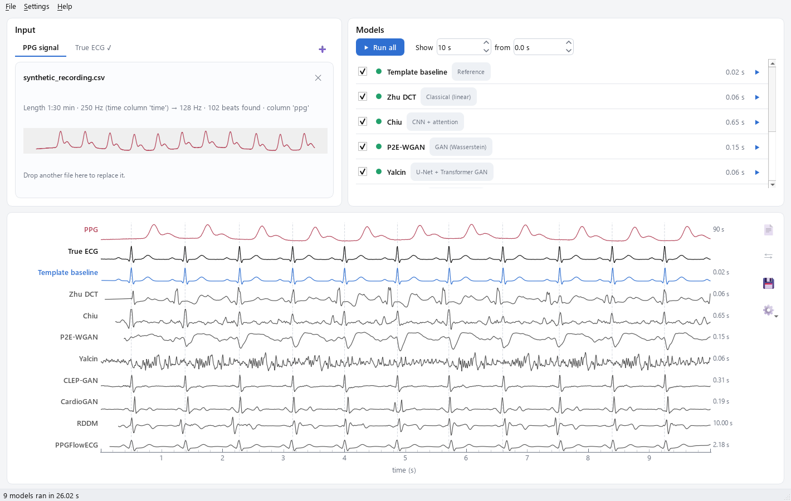
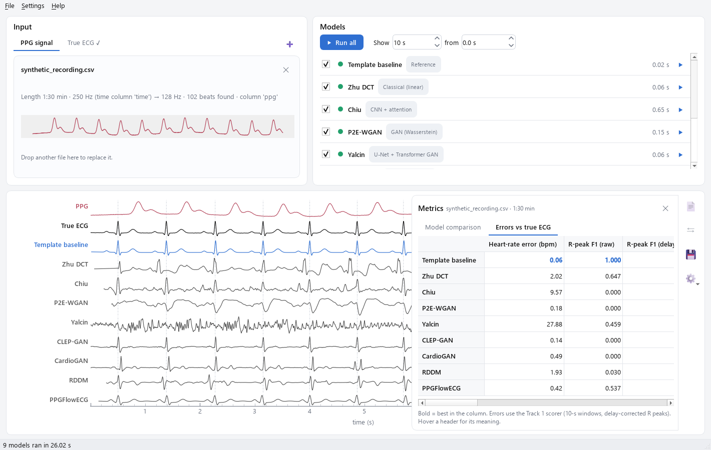

# PPG2ECG Studio

PPG2ECG Studio is a Windows app that reconstructs an ECG from a PPG (the pulse signal of a finger or wrist
sensor). Drop a PPG file and it runs nine reconstruction methods, from a simple baseline to diffusion models,
plots their ECGs under each other, and scores them with the same measures as Track 1 of the PPG2ECG thesis;
add the true ECG and it also measures how close each one comes.



## Contents

1. [Set up](#1-set-up)
2. [Run](#2-run)
3. [What works in version 0.2](#3-what-works-in-version-02)
4. [Example recordings](#4-example-recordings)

Reference: [What the app does with your file](#what-the-app-does-with-your-file) ·
[Measurements](#measurements) · [Command line](#command-line) ·
[Check that the numbers match Track 1](#check-that-the-numbers-match-track-1) · [Setup flags](#setup-flags) ·
[Adding a model](#adding-a-model) · [Repository layout](#repository-layout) · [Roadmap](#roadmap) ·
[References](#references)

## 1. Set up

**You need:** Windows 10 or 11 (64-bit), about 8 GB of free disk space, 8 GB of RAM (16 GB for PPGFlowECG),
and an internet connection for the first setup (about 5.5 GB of downloads). No administrator rights and no
Python installation are needed.

1. **Get the code.** On this repository's GitHub page, click the green *Code* button and either choose
   *Download ZIP* and unzip it, or copy the address and run `git clone <address>` in a terminal.
   Put the folder somewhere with a short path and no special characters, for example `C:\PPG2ECG`.

2. **Double-click `setup.bat`** in that folder. A console window opens and shows each step:

   | Step | What happens | Time |
   |---|---|---|
   | Tools | Downloads [uv](https://github.com/astral-sh/uv) into `.tools\uv`; uv provides a private Python 3.11 | 1 min |
   | Packages | Creates `.venv` and installs the pinned packages of `requirements.txt` (Qt, SciPy, PyTorch for the CPU, ONNX Runtime) | 2–5 min |
   | Models | Downloads the nine methods and the authors' code, checks every file's SHA-256, converts five networks to ONNX and checks each conversion | 10–30 min (most of it PPGFlowECG's 3.9 GB) |
   | Self-test | Runs every model on a synthetic PPG, measures its speed and chooses GPU or CPU for it | 1 min |
   | Shortcuts | Adds **PPG2ECG Studio** to the Start menu and the desktop | – |

3. **Wait for `Done.`** The last table lists each model with `yes` under *installed*. If a model is reported
   as not installed, the line above it says why; the app works without it, and you can add it later:

   | Message | What to do |
   |---|---|
   | *Google Drive refused the download* (RDDM) | Open the printed link, download the three `.pth` files into one folder, then run `setup.bat --rddm --offline C:\that\folder` |
   | *PPGFlowECG: skipped – needs about 5 GB of RAM* | Use a computer with 16 GB of RAM, or run `setup.bat --ppgflowecg --force` |
   | A download failed | Run `setup.bat` again: finished models are kept and interrupted downloads resume |

Running `setup.bat` again is always safe. To install only some methods, run it from a terminal with flags,
for example `setup.bat --chiu --clepgan` ([all flags](#setup-flags)).

### Where the weights come from

| Method | Source | Download | On disk |
|---|---|---|---|
| Zhu DCT, Chiu, CLEP-GAN, P2E-WGAN, Yalcin | This repository's GitHub Release (our weights; CLEP-GAN stored as fp16) | 0.3 GB | 0.6 GB |
| CardioGAN | The authors' GitHub release (TF2 checkpoint), converted to ONNX on your computer with a temporary TensorFlow 2.15 (deleted afterwards) | 0.2 GB + 0.3 GB TensorFlow | 0.1 GB |
| RDDM | The authors' Google Drive folder | 0.6 GB | 0.6 GB |
| PPGFlowECG | The authors' Hugging Face page; the 3.8 GB VAE checkpoint is reduced to the parts inference needs | 3.9 GB | 0.9 GB |

The authors' code is downloaded from their repositories at the commit Track 1 used. Nothing of theirs is
re-hosted here ([THIRD_PARTY.md](THIRD_PARTY.md) lists every source, commit and licence). Every file is checked
against the SHA-256 in its `models/<id>/model.yaml`, and downloads resume after an interruption.

The networks of CardioGAN, Chiu, CLEP-GAN, P2E-WGAN and Yalcin are exported to ONNX at setup, and each export
is checked against the original framework (largest difference printed; about 10⁻⁶). They run on the GPU
through DirectML (any GPU Windows has; CUDA when `onnxruntime-gpu` and an NVIDIA GPU are present) when that
works, agrees with the CPU and is faster; otherwise on the CPU. On an Intel Iris Xe, DirectML is about as fast
as the CPU for these small networks (and fails on Chiu's and P2E-WGAN's transposed convolutions), so most of
them stay on the CPU. The choice is stored in `weights\device.json`; `setup.bat --check` measures again.

### Fitting Zhu DCT yourself (optional)

Setup downloads Zhu DCT's 1,300 coefficients from the Release. To fit them on your computer from CapnoBase
instead (about a minute), exactly as in Track 1:

```bat
setup.bat --zhu --capnobase C:\path\to\capnobase
```

`PATH` is the folder with the 42 CapnoBase recordings, in any of the forms it is distributed in
(`*_8min.mat`, `*_8min_signal.csv` or the Borealis `*.tab` files; [doi:10.5683/SP2/NLB8IT](https://doi.org/10.5683/SP2/NLB8IT)).
The CSV and TAB files are read first; only a recording that exists solely as a `.mat` file (MATLAB v7.3) needs
`h5py`, which setup then installs into `.venv`. The fit reports whether it reproduces Track 1 (27,661 cycles,
delays 0.234375 s for Zhu DCT and 0.3828125 s for the template).

## 2. Run

**Start the app** from the *PPG2ECG Studio* shortcut, or double-click **`run.bat`** in the folder
(`run.bat --console` keeps a console window open for error messages).

The window opens in about 2 seconds. The models load in the background and each one's dot turns green when
it is ready: on an Intel i5-1240P laptop the template baseline and Zhu DCT after about 6 s, the ONNX models
after about 8 s, RDDM and PPGFlowECG after about 15 s. A ready model can run while the others are still
loading.

**A first run with an example recording** (in the [`examples`](examples) folder):

1. Drag `examples\bidmc_25_full_8min.csv` onto the *PPG signal* tab.
2. The file is 8 minutes long, so a pop-up offers its first 2 minutes: choose *Use the first 2 minutes*.
   The file card shows 125 Hz → 128 Hz and the beats found; the *True ECG* tab fills itself from the file's
   ECG column and a side notification says so.
3. Press **Run all**. The ECGs appear one by one, fastest method first; all nine take about 30 s on the
   laptop above, most of it RDDM.
4. The metrics drawer opens: *Model comparison* and *Errors vs true ECG*, best values in bold.
5. Change *Show [10] s from [0] s* to look at other parts; scroll to zoom, drag to pan, double-click to reset.

To try a PPG and a true ECG from separate files, drop `examples\bidmc_13_ppg_2min.csv` on the *PPG signal*
tab and `examples\bidmc_13_ecg_2min.csv` on the *True ECG* tab; they are aligned by their time columns.

## 3. What works in version 0.2

**Input files**

- CSV, TXT, NPY and NPZ, from 10 s to 2 min (longer files: the first 2 minutes are used), up to 20 MB.
- Any sampling rate, found from a time column (seconds or milliseconds), a `# fs=125` comment, an `fs` array
  in an NPZ, `_125Hz` in the file name, the rate remembered for that folder, or a question to you.
- The signal column is chosen by name (`ppg`, `pleth`, `bvp`; `ecg`, `ii`); with several unnamed columns the
  app asks once. An ECG column in the PPG file becomes the true ECG automatically.
- 2-D arrays are read as rows of windows and joined (overlapping sliding windows are recognised); short gaps of
  missing values are filled; an upside-down PPG is flipped; PPG and true ECG are aligned by their time stamps.
- Every file is converted to 128 Hz for plotting and scoring; each model gets the signal at the file's own
  rate and resamples it once to its own rate, as in Track 1.

**The nine methods**

| Method | Family | Runs on | Weights |
|---|---|---|---|
| Template baseline | Reference (one fixed beat per pulse) | NumPy | built in |
| Zhu DCT | Classical (DCT + ridge regression) | NumPy | ours, fitted on CapnoBase |
| Chiu | CNN + attention | ONNX Runtime | ours, trained with the authors' code |
| CLEP-GAN | GAN (contrastive) | ONNX Runtime | ours, trained with the authors' code |
| P2E-WGAN | GAN (Wasserstein) | ONNX Runtime | ours, trained with the authors' code |
| Yalcin | U-Net + Transformer GAN | ONNX Runtime | ours, trained with the authors' code |
| CardioGAN | GAN (attention U-Net) | ONNX Runtime | the authors' release |
| RDDM | Diffusion (10 steps) | PyTorch | the authors' release |
| PPGFlowECG | Latent rectified flow | PyTorch | the authors' release |

**Running**

- The models load and run in a separate engine process, so the window never freezes; if a model crashes,
  only the engine restarts and a side notification says so.
- *Run all* (Ctrl+R) runs every ticked model, fastest first; ▶ on a row runs one model. Each row shows the
  model's state (grey dot: loading, green: ready, red: failed) and its generation time.
- RDDM and PPGFlowECG draw random samples with a fixed seed, so a file gives the same result every time.
- The status bar shows the device in use (GPU through DirectML, or the CPU) and how many models are ready.

**Plots**

- Stacked traces: PPG, true ECG (black), template baseline (blue), the other methods (grey), all on one time
  axis; plot window 2–15 s; zoom, pan, reset; time and value under the mouse in the status bar.
- ⚙ *Display options*: align each reconstruction to the true ECG (removes its one constant delay, as the
  scorer does), show the true R peaks, band-pass 0.5–40 Hz as scored.

**Measurements** (the 📄 metrics drawer, [details](#measurements))

- *Model comparison*, without a true ECG: heart rate of the reconstruction and of the PPG, beats against
  pulses, RMSSD, flags (flat output, missing or extra beats), generation time, real-time factor, device.
- *Errors vs true ECG*, the Track 1 scorer: heart-rate error, R-peak F1 (raw and delay-corrected), delay,
  R-peak jitter, waveform r, beat-shape r, RMSE, PRD, Fréchet distance, RMSSD error.



**Notifications**

| Situation | What you see |
|---|---|
| File shorter than 10 s | Big central pop-up; Run stays disabled for that file |
| File longer than 2 min | Central pop-up offering to use its first 2 minutes |
| No heartbeats found (flat line, noise, wrong column or rate) | Dismissable pop-up; the models can still run |
| Fewer than 20 beats or under 30 s | Side notification: measurements will be rough |
| Sampling rate implies a heart rate outside 36–210 bpm | Side notification with the implied rate |
| PPG upside down | Flipped automatically, side notification |
| Windows joined, gaps filled, clipped samples, true ECG upside down, aligned by time stamps, no true ECG | Side notification |

Any conversion that takes longer than 0.3 s shows a spinner: *Adjusting data to preferred format…*

**Also included**

- A [command line](#command-line) with the same intake, models and scorer.
- `setup.bat` flags to install, list, remove and re-check models, and to choose the device ([flags](#setup-flags)).
- Tests, including a check that the app reproduces the Track 1 numbers of all nine methods on BIDMC
  ([details](#check-that-the-numbers-match-track-1)).

**Not yet:** export (PNG, PDF, TXT, reconstructed ECG files), a cache of earlier runs, files longer than
2 minutes, comparing two runs, and checks for adding new models. These follow in versions 0.3 and 0.4
([Roadmap](#roadmap)).

## 4. Example recordings

The [`examples`](examples) folder holds 15 short real recordings for trying the app: PPG (and mostly the true
ECG) from BIDMC and from the UCI Cuff-Less Blood Pressure dataset (MIMIC-II), 8 s to 8 min, heart rates from 66 to 125 bpm,
in every file layout the app reads, including files that trigger each notification. The table, sources and
licences are in [examples/README.md](examples/README.md).

## What the app does with your file

Every file becomes one continuous 128 Hz signal before a model sees it (`studio/intake/`):

| Step | Script | What happens |
|---|---|---|
| Read | `readers.py` | Delimiter and header detected; non-numeric rows dropped. The signal column is chosen by name (`ppg`, `pleth`, `bvp` for the PPG; `ecg`, `ii` for the ECG, lead II preferred); with several unnamed columns the app asks once. |
| Sampling rate | `fs_adjust.py` | From a time column (seconds or ms; rounded time stamps are fine), a `# fs=125` comment, an `fs` array in an NPZ, `_125Hz` in the file name, the rate remembered for that folder, or else the app asks. The pulse rate implied by that rate must lie at 36–210 bpm. Resampled to 128 Hz with the benchmark's anti-aliased polyphase filter. |
| Window layout | `window_adjust.py` | A 2-D array is rows of windows (any length); rows are joined in order. Sliding windows that overlap are recognised and the overlap kept once. NaN gaps up to 1 s are interpolated; at longer gaps the longest continuous part is used. |
| Checks | `checks.py` | Length limits, flat line, clipping, PPG polarity (an upright pulse rises faster than it falls), pulses present and periodic, true-ECG R peaks and polarity. |
| Align | `pipeline.py` | PPG and true ECG start together (or by their time stamps when both have them) and are trimmed to their overlap. |

The plots and the scorer use this 128 Hz signal. The models are given the same signal at the file's own rate
(after the same joins, gap filling, cropping and flipping), and `bench.runner.run_record` resamples it once,
straight to each model's own rate (125 Hz for Chiu, CLEP-GAN and P2E-WGAN), exactly as in Track 1. Each model
then cuts its own windows with its authors' preprocessing and stitching:

| Method | Rate, window | Stitching |
|---|---|---|
| Template baseline, Zhu DCT | 128 Hz, 10 s | overlap 0.5, tapered |
| Chiu | 125 Hz, 2.048 s | overlap 0.5, middle half of each window kept (the authors' rule) |
| CLEP-GAN | 125 Hz, 4.096 s | overlap 0.5, tapered |
| P2E-WGAN | 125 Hz, 3 s | overlap 0.5, tapered |
| Yalcin, CardioGAN | 128 Hz, 4 s | overlap 0.5, tapered |
| RDDM | 128 Hz, 4 s | windows side by side (each one is an independent sample) |
| PPGFlowECG | 128 Hz, 10 s | windows side by side (each one is an independent sample) |

The whole file is always reconstructed; the plot length only chooses what is drawn.

## Measurements

*Errors vs true ECG* is `bench.metrics.evaluate` with the Track 1 settings (10-s windows, Fréchet distance on at
most 20 windows); each value is the mean over 10-s windows, plus record-level values for R peaks and RMSSD.

| Column | Meaning |
|---|---|
| Heart-rate error | Mean absolute HR error per 10-s window (bpm) |
| R-peak F1 (raw / delay-corrected) | R peaks within 150 ms of the true ones; delay-corrected after removing the record's one constant delay (the Track 1 headline) |
| Delay | That constant delay (ms) |
| R-peak jitter | Inter-quartile range of R-peak timing errors after the delay (ms) |
| Waveform r (raw / best lag) | Pearson r per window, unshifted / at the best shift within ±300 ms |
| Beat shape r | Mean correlation of matched beats, each centred on its own R peak (the Track 1 morphology metric) |
| RMSE, PRD, Fréchet distance | Waveform distances with both signals scaled to [-1, 1] per window |
| RMSSD error | Difference in beat-to-beat variability (ms) |

*Model comparison* needs no true ECG: heart rate of the reconstruction and of the PPG pulses, beats drawn and
pulses found, their agreement (F1 after removing the constant pulse delay), RMSSD of both, flags (flat output,
missing or extra beats), generation time, real-time factor and device. Generation time is the wall-clock time of
the model's own run (windowing, inference, stitching), not loading and not the shared conversion.

## Command line

The same intake, models and scorer without the window:

```bat
.venv\Scripts\python -m studio.cli recording.csv --ecg same
.venv\Scripts\python -m studio.cli ppg.npy --rate 125 --ecg ecg.csv --models template,clep_gan,rddm --out results
```

`--ecg same` takes the true ECG from the PPG file; `--full` lifts the 2-minute limit; `--out` writes each
reconstruction as a CSV (time, ECG at 128 Hz).

## Check that the numbers match Track 1

The tests cover the intake (every supported layout of the same signal must give the same 128 Hz signal), the
engine, the window (driven off-screen) and, with BIDMC, the Track 1 numbers:

```bat
set BIDMC_DIR=C:\path\to\bidmc-ppg-and-respiration-dataset-1.0.0\bidmc_csv
run_tests.bat
```

`tests/test_track1.py` runs the app's own intake and engine on the whole 8-min BIDMC recordings 01, 05 and 27
and compares heart-rate error, delay-corrected R-peak F1, beat-shape r, waveform r, Fréchet distance and RMSSD
error with `results/track1/subjects_cons.csv` of the thesis, for every installed method (agreement to about
10⁻³; Track 1 stored predictions in float16 before scoring). PPGFlowECG is the exception: Track 1 drew its
random samples on a CUDA GPU, which gives different random numbers than a CPU for the same seed, so the app's
output is a different sample of the same model; it is compared within 3.5 standard deviations of the
difference between two samples (measured over nine seeds; the tolerances are in the test). RDDM was sampled on
the CPU in Track 1 and matches exactly. By hand:

```bat
.venv\Scripts\python -m studio.cli %BIDMC_DIR%\bidmc_01_Signals.csv --ecg same --full
```

Track 1 on BIDMC 01 (whole record, clean). The app gives the same values to the digits shown for every
method except PPGFlowECG, whose app values are in the last row:

| BIDMC 01 | Heart-rate error | R-peak F1 (dc) | Beat shape r | Waveform r (lag) | Fréchet | RMSSD error |
|---|---|---|---|---|---|---|
| Template baseline | 1.207 | 0.988 | 0.920 | 0.786 | 1.643 | 56.5 |
| Zhu DCT | 0.944 | 0.982 | 0.815 | 0.626 | 1.599 | 67.5 |
| Chiu | 3.293 | 0.978 | 0.852 | 0.782 | 1.635 | 53.2 |
| CLEP-GAN | 0.776 | 0.991 | 0.965 | 0.852 | 1.930 | 30.8 |
| P2E-WGAN | 15.046 | 0.868 | 0.297 | 0.285 | 1.749 | 400.4 |
| Yalcin | 24.226 | 0.405 | 0.339 | 0.199 | 1.816 | 335.7 |
| CardioGAN | 1.713 | 0.982 | 0.723 | 0.158 | 1.881 | 90.8 |
| RDDM | 1.395 | 0.982 | 0.672 | 0.441 | 1.797 | 42.6 |
| PPGFlowECG | 0.430 | 0.978 | 0.663 | 0.572 | 1.879 | 35.3 |
| PPGFlowECG, app (seed 0, CPU) | 0.332 | 0.981 | 0.669 | 0.586 | 1.901 | 21.8 |

Track 1 marks CardioGAN's BIDMC results as seen (its released weights saw every BIDMC subject), those of
Chiu, CLEP-GAN, P2E-WGAN, RDDM and PPGFlowECG as possibly seen, and Yalcin's, Zhu DCT's and the template's as
unseen.

In the window, BIDMC files are 8 min long, so the app offers their first 2 minutes; those numbers differ from
the whole-record values above, as they should.

## Setup flags

`setup.bat` passes its arguments to `setup.py` (`--all` when double-clicked). After the first run,
`.venv\Scripts\python setup.py …` works too.

| Flag | Effect |
|---|---|
| `--all` | All nine methods |
| `--zhu`, `--cardiogan`, `--ppgflowecg`, `--rddm`, `--clepgan`, `--chiu`, `--p2e`, `--yalcin` | Only these methods (the template baseline is always installed) |
| `--capnobase PATH` | Fit Zhu DCT (and refit the template delay) from CapnoBase instead of downloading |
| `--offline FOLDER` | Install weight files downloaded by hand (found by file name anywhere in FOLDER) |
| `--list` | Available and installed models, flags, sizes, device and measured speed |
| `--remove ID` | Uninstall a model and free its space |
| `--check` | Re-run the self-test and speed measurement and choose each ONNX model's device again (after a driver or hardware change) |
| `--device auto\|gpu\|cpu` | Override the automatic device choice for the ONNX models |
| `--force` | Reinstall, or install although disk space or RAM look short |
| `--shortcut` / `--no-shortcut` | Create the shortcuts / skip them |

## Adding a model

A model is a folder `models/<id>/` with `model.yaml` (manifest: name, family, sampling rate, window length,
overlap, stochastic, runtime, weight files with URLs and SHA-256, optionally the authors' repository and
commit, the files that mean "installed", citation, licence) and `adapter.py` with `build(ctx)` returning an
adapter that has `load()` and `infer(windows)`: the interface every built-in method uses
(`bench/models/base.py`). An optional `setup(ctx, say)` in `adapter.py` runs once after the files are
downloaded (the built-in models use it to export ONNX and to trim checkpoints). Copy `models/_example/` to
start; weight files go in `weights/<id>/`. Any such folder is picked up at start; `setup.py --add-model`
with its automatic checks (interface, speed, determinism, memory, citation and licence) arrives in v0.4.

## Repository layout

```
setup.bat  setup.py  run.bat  run_tests.bat  requirements.txt
studio/
  app.py            start the window (python -m studio)
  cli.py            command-line run
  config.py         limits, rates, paths, per-user settings (%LOCALAPPDATA%\PPG2ECG Studio)
  intake/           readers.py, fs_adjust.py, window_adjust.py, checks.py, pipeline.py
  engine/           model registry, engine process (process.py), device probe, ONNX Runtime and export
                    (onnx_run.py), our four trained models through ONNX (trained.py), reconstruction
  scoring/          Track 1 scorer (bench.metrics) + PPG-referenced measures
  ui/               main window, input and model panels, plots, metrics drawer, notifications
bench/              trimmed copy of the thesis benchmark: dsp, metrics, runner, record, the adapters of the
                    nine methods, BIDMC / CapnoBase readers, beat pairing (kept identical so scores match Track 1)
models/             template/ zhu_dct/ chiu2020/ clep_gan/ p2e_wgan/ yalcin2026/ cardiogan/ rddm/ ppgflowecg/
                    _example/   (model.yaml + adapter.py each)
weights/            installed weights, the authors' code, device.json, speed.json (not in Git)
examples/           15 short real recordings to try the app (BIDMC, MIMIC-II), with their sources and licences
tools/              fit_baselines.py (Zhu DCT and template delay from CapnoBase),
                    stage_weights.py (our trained weights -> Release assets),
                    make_examples.py (builds examples/ from BIDMC and the UCI Cuff-Less dataset),
                    convert_cardiogan.py (TF2 -> ONNX, run by setup in a temporary environment),
                    make_screenshots.py (the README images, from a synthetic recording)
docs/               windows_checklist.md (manual check), screenshots/
tests/              intake, engine, engine process, model interfaces, window, Track 1 reproduction
```

No data and no weights are kept in Git. The screenshots are rendered from a synthetic recording
(`bench.datasets.make_synthetic`) with `.venv\Scripts\python tools\make_screenshots.py`.

## Roadmap

| Version | Adds |
|---|---|
| 0.1 | Default workflow with the template baseline and Zhu DCT: intake and conversion, window, plots, metrics drawer, notifications, setup with flags |
| 0.2 | The seven learned models (CardioGAN, PPGFlowECG, RDDM, CLEP-GAN, Chiu, P2E-WGAN, Yalcin) through ONNX Runtime (DirectML / CUDA / CPU) and PyTorch, in a separate engine process; device probe; downloads with checksums; speed measured at setup |
| 0.3 | Export (PNG / PDF + TXT, one PDF, reconstructed ECG files in the input's format), Save / Save as, cache of earlier entries |
| 0.4 | Large-file mode (up to 2 h, preview, time left, Abort), compare with a previous entry, resident engine, `--add-model` checks |

## References

Methods:

- Sarkar P, Etemad A. CardioGAN: Attentive generative adversarial network with dual discriminators for
  synthesis of ECG from PPG. *AAAI*, 2021.
- Shome D, Sarkar P, Etemad A. Region-disentangled diffusion model for high-fidelity PPG-to-ECG translation.
  *AAAI*, 2024.
- Chiu H-Y, Shuai H-H, Chao PC-P. Reconstructing QRS complex from PPG by transformed attentional neural
  networks. *IEEE Sensors Journal*, 2020.
- Vo K et al. P2E-WGAN: ECG waveform synthesis from PPG with conditional Wasserstein generative adversarial
  networks. *ACM SAC*, 2021.
- Li X, Xu S, Habib F, Aminnejad N, Gupta A, Huang H et al. CLEP-GAN: an innovative approach to
  subject-independent ECG reconstruction from PPG signals. *BMC Bioinformatics* 26:306, 2025.
- Fang X, Jin J, Wang H et al. PPGFlowECG: Latent rectified flow with cross-modal encoding for PPG-guided ECG
  generation and cardiovascular disease detection. arXiv:2509.19774, 2025.
- Yalcin and Latoschik. End-to-end non-invasive ECG signal generation from PPG signal: a self-supervised
  learning approach. *Frontiers in Physiology*, 2026.

Baseline, data and signal processing:

- Zhu Q, Tian X, Wong C-W, Wu M. ECG reconstruction via PPG: a pilot study. *IEEE EMBS International Conference on
  Biomedical and Health Informatics (BHI)*, 2019. [arXiv:1904.10481](https://arxiv.org/abs/1904.10481)
- Pimentel MAF, Johnson AEW, Charlton PH, et al. Toward a robust estimation of respiratory rate from pulse
  oximeters. *IEEE Transactions on Biomedical Engineering* 64(8):1914–1923, 2017. (BIDMC dataset,
  [PhysioNet](https://physionet.org/content/bidmc/1.0.0/))
- Goldberger AL, Amaral LAN, Glass L, et al. PhysioBank, PhysioToolkit, and PhysioNet. *Circulation*
  101(23):e215–e220, 2000.
- Karlen W, Raman S, Ansermino JM, Dumont GA. Multiparameter respiratory rate estimation from the
  photoplethysmogram. *IEEE Transactions on Biomedical Engineering* 60(7):1946–1953, 2013. (CapnoBase)
- Pan J, Tompkins WJ. A real-time QRS detection algorithm. *IEEE Transactions on Biomedical Engineering*
  32(3):230–236, 1985.
- Elgendi M, Norton I, Brearley M, Abbott D, Schuurmans D. Systolic peak detection in acceleration
  photoplethysmograms measured from emergency responders in tropical conditions. *PLoS ONE* 8(10):e76585, 2013.

Third-party software and licences: [THIRD_PARTY.md](THIRD_PARTY.md). The licence of this repository has not
been chosen yet.
